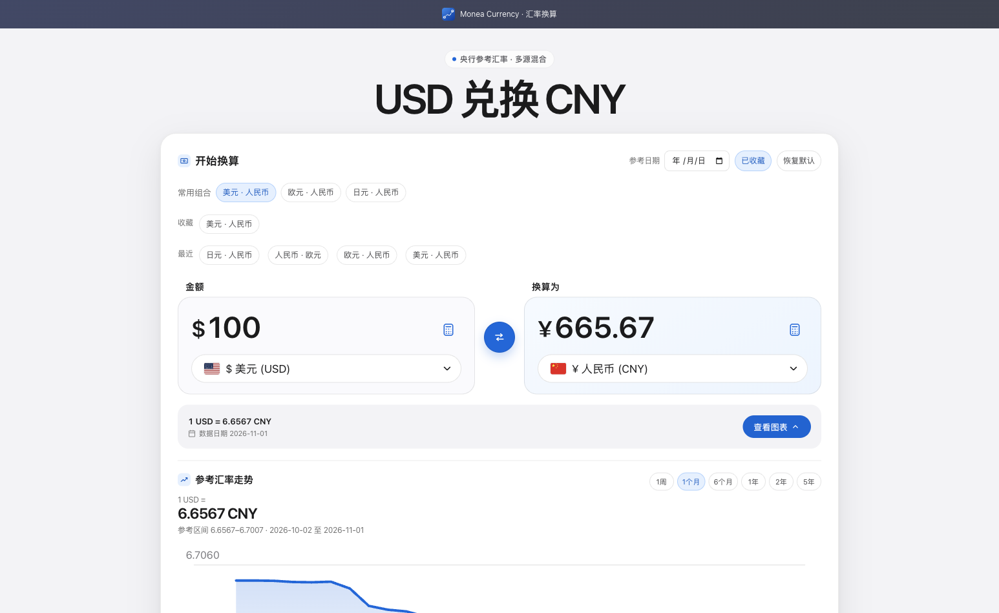

# Monea Currency

<p align="center">
  
</p>

> 全球货币，轻松换算。

一个部署在 Cloudflare Workers 上的汇率换算工具，提供网页界面与 JSON API。汇率来自 [Frankfurter](https://frankfurter.dev/) 汇聚的中央银行参考数据，不是实时交易报价，也无需 API Key。

## 功能

- 搜索并选择多种货币，输入金额后即时换算；支持交换方向、设置参考日期和收藏货币组合。
- 保存最近使用的货币组合，并提供常用组合快捷入口。
- 按需查看汇率走势，支持 1 周、1 个月、6 个月、1 年、2 年和 5 年区间。
- 汇率走势图按需加载；浏览器会缓存近期走势图数据，服务端同时使用 Cloudflare 边缘缓存。
- 货币列表中的国旗在打开列表后按可见区域加载。首次成功加载后会写入浏览器 Cache Storage，后续优先从本地读取；缓存不可用时会回退到普通图片请求。首屏不预加载列表国旗。浏览器仍可能因存储压力、隐私策略或用户操作清理缓存。
- 页面内提供计算器，支持用算式辅助输入金额。

## 本地开发

需要 Node.js 和 Corepack。安装依赖并启动 Wrangler 本地开发服务器：

```bash
corepack pnpm install
corepack pnpm dev
```

默认地址为 <http://localhost:8787>。

保存源码后，本地页面会自动刷新；这是整页刷新，未保存的输入可能丢失。`assets/history-client.js` 使用长期缓存，开发时可在浏览器开发者工具中禁用 HTTP 缓存；修改该文件或国旗资源后，仍需按项目约定更新对应的版本参数。

运行 Worker 测试和类型检查：

```bash
corepack pnpm test
corepack pnpm exec tsc --noEmit
```

计算器浏览器回归测试需安装并连接 `ego-browser`，并先在另一个终端启动开发服务器：

```bash
corepack pnpm test:ui
```

部署到 Cloudflare Workers：

```bash
corepack pnpm deploy
```

## API

所有 API 仅接受 `GET`；`OPTIONS` 用于 CORS 预检。错误响应为 JSON，常见无效参数返回 HTTP 400。`/api` 返回服务信息和端点列表。

| 端点 | 用途 |
| --- | --- |
| `/convert?from=USD&to=CNY&amount=100` | 汇率换算；可选 `date=YYYY-MM-DD` 查询指定日期 |
| `/history?from=USD&to=CNY&range=1M` | 汇率走势；`range` 支持 `1D`、`1W`、`1M`、`6M`、`1Y`、`2Y`、`5Y` |
| `/latest?base=USD` | 返回指定基准货币的汇率及各自数据日期 |
| `/currencies` | 返回上游货币目录 |
| `/health` | 返回 Worker 和上游状态信息 |
| `/api` | 返回 API 说明 |

换算金额必须是非负十进制数。`/convert` 的响应示例：

```json
{
  "from": "USD",
  "to": "CNY",
  "amount": 100,
  "rate": 6.77,
  "result": 677,
  "date": "2026-07-26"
}
```

`/latest` 为每个货币分别返回数据日期，避免把不同来源的更新时间误写成同一天：

```json
{
  "base": "USD",
  "rates": {
    "CNY": { "rate": 6.77, "date": "2026-07-26" }
  }
}
```

## 缓存

- 最新汇率在 Cloudflare 边缘缓存 5 分钟；上游出错时可使用最近成功结果兜底。
- 指定日期汇率缓存 1 天，并在后续 30 天内提供陈旧数据兜底。
- 历史走势缓存 1 天，并在后续 7 天内提供陈旧数据兜底。
- 货币目录缓存 7 天，并在后续 30 天内提供陈旧数据兜底。
- 每天通过 Cron 预热 10 种常用基准货币；其余货币按需加载。
- 页面 HTML 不缓存，确保刷新时取得最新界面脚本；静态国旗设置一年浏览器缓存，并通过版本参数更新。

## 致谢

汇率数据由开源项目 [Frankfurter](https://frankfurter.dev/) 提供。感谢其维护免费的货币数据 API 与公开数据来源；如需合规用途，请通过其 `providers` 参数选择对应的官方数据源。
